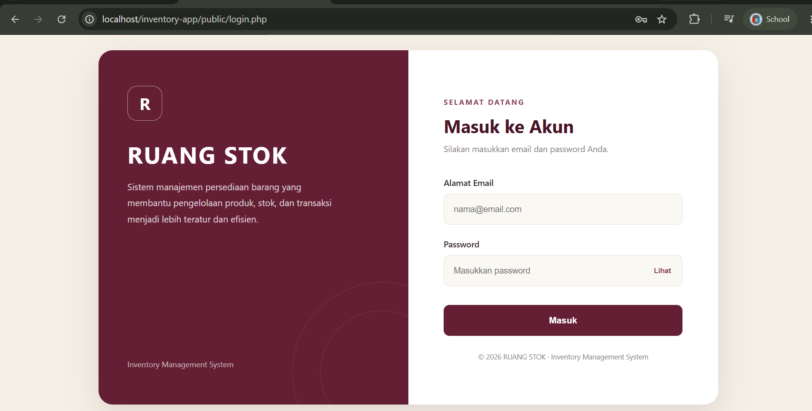

# Inventory Management System

**Aplikasi Sistem Informasi Manajemen Inventaris Berbasis PHP Native**

## 📌 Deskripsi Proyek

Inventory Management System merupakan aplikasi berbasis web yang dikembangkan menggunakan PHP Native dan MySQL untuk membantu proses pengelolaan inventaris barang secara lebih terstruktur dan efisien.

Aplikasi ini menyediakan fitur pengelolaan produk, kategori, supplier, transaksi stok, riwayat stok, serta laporan inventaris. Sistem juga dilengkapi dengan autentikasi pengguna dan pembagian hak akses berdasarkan peran Admin dan Staff.

## 🎯 Tujuan

- Mempermudah pengelolaan data inventaris.
- Membantu pencatatan barang masuk dan keluar.
- Memantau perubahan dan ketersediaan stok.
- Mempermudah pengelolaan supplier dan kategori.
- Menyediakan laporan inventaris.
- Menerapkan pembagian hak akses pengguna.

## 🛠️ Teknologi yang Digunakan

- **PHP Native** — Bahasa pemrograman backend.
- **MySQL** — Database penyimpanan data.
- **HTML** — Struktur halaman web.
- **CSS** — Desain dan tampilan aplikasi.
- **XAMPP** — Server lokal untuk menjalankan aplikasi.
- **Git & GitHub** — Pengelolaan dan penyimpanan kode sumber.

## ✨ Fitur Aplikasi

### 1. Admin
- Login dan logout.
- Dashboard inventaris.
- Manajemen produk (tambah, lihat, edit, hapus).
- Manajemen kategori.
- Manajemen supplier.
- Pengelolaan transaksi stok.
- Riwayat pergerakan stok.
- Manajemen pengguna.
- Pembuatan akun Staff.
- Melihat laporan inventaris.

### 2. Staff
- Login dan logout.
- Melihat dashboard.
- Melihat data produk.
- Melihat kategori.
- Melihat data supplier.
- Melihat riwayat stok.
- Melihat transaksi stok.
- Melihat laporan inventaris.

## 📂 Struktur Folder

```text
inventory-app/
│
├── config/
│   └── database.php
│
├── database/
│   └── schema.sql
│
├── helpers/
│   ├── auth.php
│   ├── escape.php
│   └── validation.php
│
├── public/
│   ├── assets/
│   │   └── css/
│   │       └── style.css
│   ├── categories/
│   ├── products/
│   ├── stock/
│   ├── suppliers/
│   ├── dashboard.php
│   ├── login.php
│   ├── logout.php
│   ├── reports.php
│   ├── users.php
│   └── create_staff.php
│
├── screenshots/
│
├── views/
│   └── header.php
│
└── README.md
```

## ⚙️ Cara Instalasi

1. Clone repository:

```bash
git clone https://github.com/Luthfia0507/Inventory-app.git
```

2. Pindahkan folder proyek ke direktori `htdocs` pada XAMPP.

3. Jalankan Apache dan MySQL melalui XAMPP Control Panel.

4. Buat database MySQL dengan nama `inventory-app`.

5. Import file `database/schema.sql` melalui phpMyAdmin.

6. Sesuaikan konfigurasi database pada `config/database.php` dengan pengaturan MySQL lokal.

7. Buka aplikasi melalui browser:

```text
http://localhost/inventory-app/public/login.php
```

## 📸 Dokumentasi Tampilan Aplikasi

### 1. Halaman Login



### 2. Dashboard

**Dashboard Admin**


**Dashboard Staff**


### 3. Manajemen Produk

**Produk Admin**


**Produk Staff**


### 4. Manajemen Kategori

**Kategori Admin**


**Kategori Staff**


### 5. Manajemen Supplier

**Supplier Admin**


**Supplier Staff**


### 6. Transaksi dan Riwayat Stok

**Transaksi Stok Admin**


**Transaksi Stok Staff**


**Riwayat Stok Admin**


**Riwayat Stok Staff**


### 7. Laporan Inventaris

**Laporan Admin**


**Laporan Staff**


### 8. Manajemen Pengguna


---

## 👩‍💻 Pengembang

**Luthfia Putri**

Project: Web Programming — Web 4

Repository: [Inventory-app](https://github.com/Luthfia0507/Inventory-app)

---

*Dikembangkan sebagai proyek pembelajaran dan implementasi sistem informasi manajemen inventaris berbasis web.*